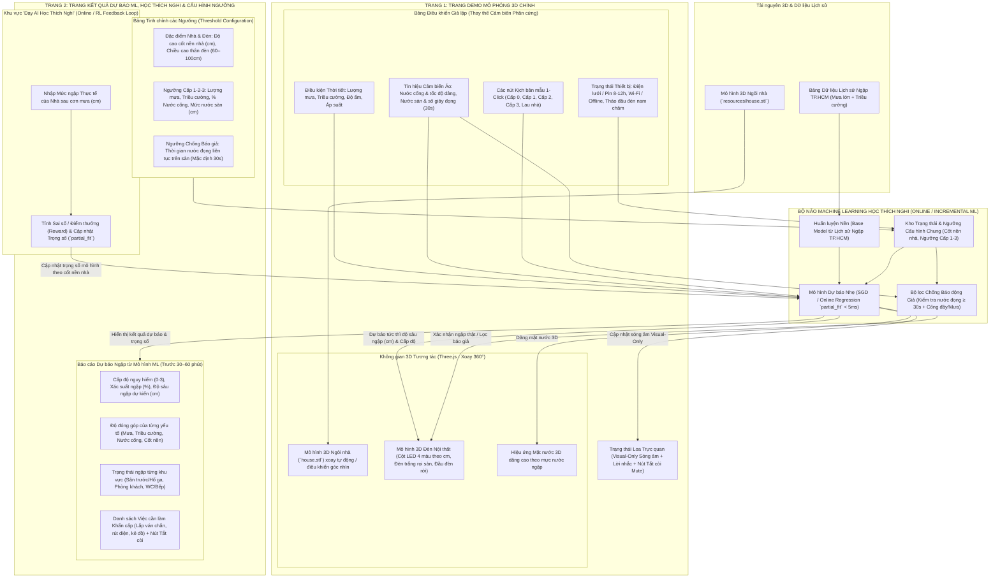

# Cấu Trúc Sản Phẩm và Cấu Trúc Thư Mục Dự Án (Product & Folder Structure)

> **Phạm vi dự án hiện tại (Project Scope)**: Triển khai **100% trên Phần mềm (Software-only Web Simulation)** – Không kết nối thiết bị phần cứng thật. Toàn bộ ngôi nhà 3D ([`resources/house.stl`](file:///home/thanhduy/Projects/du_an_den_canh_bao_ngap/resources/house.stl)), chiếc đèn nội thất thông minh, tín hiệu cảm biến môi trường, bộ lọc chống báo giả và **Mô hình Machine Learning Học Trực tuyến / Tăng cường nhẹ (Online / Incremental Learning)** đều được số hóa và vận hành trên nền tảng Web.

---

## PHẦN 1: CẤU TRÚC SẢN PHẨM PHẦN MỀM (SOFTWARE PRODUCT STRUCTURE)

Sản phẩm phần mềm mô phỏng một **module đèn nội thất thông minh dự báo và cảnh báo ngập lụt đô thị**, được tổ chức xoay quanh **2 trang giao diện chính** (*Trang Demo Mô phỏng 3D* và *Trang Kết quả Dự báo ML, Học Thích Nghi & Cấu hình Ngưỡng*) kết nối với **Bộ não Machine Learning Học Trực tuyến**.

### 1.1. Sơ đồ Kiến trúc Tổng thể Phần mềm



---

### 1.2. Chi tiết Các Phân hệ trong Phạm vi Phần mềm

#### A. Trang 1: Trang Demo Mô phỏng 3D Chính (Main 3D Simulation Page)
Không gian trình diễn trực quan bằng **Three.js** thay thế hoàn toàn cho mô hình vật lý và mạch phần cứng:

1. **Khung hiển thị 3D Tương tác (Three.js 3D Viewport)**:
   - **Tải và xoay mô hình ngôi nhà ([`resources/house.stl`](file:///home/thanhduy/Projects/du_an_den_canh_bao_ngap/resources/house.stl))**: Sử dụng `STLLoader` để đọc trực tiếp file STL, đặt vào tâm khung cảnh 3D với hiệu ứng tự động xoay mượt mà (Auto-rotate) hoặc xoay 360°, phóng to/thu nhỏ góc nhìn (`OrbitControls`).
   - **Mô hình 3D Chiếc đèn Nội thất Thông minh**: Được dựng ngay trong không gian 3D cùng ngôi nhà, mô phỏng đầy đủ các tính năng của đèn:
     - **Thân đèn (tương ứng chiều cao 60–100 cm)**: Hiển thị dải sáng LED đổi 4 màu (*Vàng ấm -> Xanh dương gợn sóng -> Cam -> Đỏ chớp*) và **dâng cột sáng từ chân đèn lên đúng bằng số cm mực nước dự báo từ mô hình ML** như một thước đo trực quan.
     - **Đèn trắng chiếu sàn (Floor Downlight)**: Phát luồng sáng trắng rọi thẳng xuống mặt sàn trong không gian 3D khi ở trạng thái Khẩn cấp (Cấp 3).
     - **Đầu đèn tháo rời nam châm (Detachable Torch Head)**: Hiệu ứng tách rời phần đầu đèn khỏi đỉnh thân đèn khi kích hoạt chế độ tháo đèn pin cầm tay lúc mất điện.
   - **Hiệu ứng Mặt nước 3D (Rising Flood Water Plane)**: Lớp mặt nước bán trong suốt dâng lên hoặc hạ xuống theo mức nước ngập thực tế/dự báo quanh ngôi nhà.

2. **Hiển thị Trạng thái Loa dạng Trực quan (Visual-Only Audio Indicator)**:
   - Không phát âm thanh thật ra loa máy tính/điện thoại.
   - Hiển thị bằng **biểu đồ sóng âm động (Animated Waveform)** kèm **dòng chữ mô tả trạng thái âm thanh** theo từng cấp độ (*Im lặng*, *Tiếng chuông gió nhẹ nhàng*, *Giọng nói nhắc lắp ván chắn cửa*, *Đang hú còi báo động khẩn cấp*) và nút **Tắt tiếng còi (Mute)**.

3. **Bảng Điều khiển Mô phỏng Môi trường & Cảm biến (Virtual Sensor & Environment Controls)**:
   - Thay thế cho các cảm biến phần cứng bằng 3 nhóm điều khiển trực quan:
     - **Nhóm Thời tiết & Ngoại vi**: Thanh trượt *Lượng mưa (mm/h)*, *Triều cường (cm)*, *Độ ẩm không khí (%)*, *Áp suất khí quyển (hPa)*.
     - **Nhóm Cảm biến "Tàng hình" & Thiết bị**: Thanh trượt *Mực nước dưới cống/hố ga (%)*, *Tốc độ nước cống dâng (cm/phút)*, *Mực nước chạm sàn nhà (cm)*, *Thời gian nước đọng liên tục trên sàn (giây)* (để kiểm thử quy tắc lọc 30 giây khi lau nhà), cùng các công tắc *Mất điện lưới (Chạy Pin dự phòng 8–12h)*, *Mất Wi-Fi (Chế độ Offline độc lập)* và *Tháo rời đầu đèn nam châm*.
     - **Nhóm Kịch bản Mẫu 1-Click (Scenario Presets)**: 5 nút chọn nhanh: *(1) Ngày bình thường, (2) Dự báo sớm trước 60p, (3) Nước cống dâng trước 15–30p, (4) Ngập khẩn cấp tràn sàn, (5) Lau nhà / Đổ nước sinh hoạt*.

#### B. Bộ não Machine Learning Nhẹ Học Thích Nghi (Online / Incremental ML Engine)
Thay vì gọi LLM nặng nề và phụ thuộc mạng, hệ thống sử dụng **mô hình Machine Learning nhẹ có khả năng Học Trực tuyến / Học Tăng cường (Online Regression / SGD `partial_fit`)**:
1. **Huấn luyện Nền (Base Pre-training)**:
   - Khởi tạo từ bảng dữ liệu mô phỏng các trận ngập lịch sử tại TP.HCM (kết hợp giữa lượng mưa lớn, đỉnh triều cường, áp suất không khí và tốc độ nước cống dâng).
2. **Suy luận Tức thì (`< 5ms` Real-time Inference)**:
   - Nhận vector đặc trưng $\mathbf{x} = [\text{Lượng mưa}, \text{Triều cường}, \text{Độ ẩm}, \text{Áp suất}, \text{Nước cống}, \text{Tốc độ dâng}, \text{Cốt nền nhà}]$ để tính ra ngay **Độ sâu ngập dự kiến trong 30–60 phút tới ($\hat{y}\text{ cm}$)** và **Xác suất ngập ($\%$) Input -> Output không độ trễ**.
3. **Cơ chế Học Thích Nghi / Học Tăng cường theo Từng Ngôi nhà (Online Learning / Reward Feedback)**:
   - Khi nhận được mức ngập thực tế $y_{\text{actual}}$ sau một cơn mưa, mô hình tính sai số dự báo $e = y_{\text{actual}} - \hat{y}$ và điểm thưởng (Reward), sau đó gọi bước cập nhật trực tuyến (`partial_fit`) để điều chỉnh trọng số (weights & bias) riêng cho ngôi nhà đó. Qua vài cơn mưa, mô hình tự động hội tụ theo đúng đặc thù cốt nền và khả năng thoát nước của nhà.

#### C. Trang 2: Trang Kết quả Dự báo ML, Học Thích Nghi & Tinh chỉnh Ngưỡng (Results & Configuration Page)
1. **Khu vực Kết quả Dự báo từ Mô hình ML (ML Flood Forecast Dashboard)**:
   - **Chỉ số dự báo chính**: Cấp độ nguy hiểm dự báo (Cấp 0 – Cấp 3), Xác suất xảy ra ngập (%), **Độ sâu ngập dự kiến trong 30–60 phút tới (cm)**.
   - **Biểu đồ Đóng góp Trọng số (Feature Contribution / Explainable ML)**: Cho biết yếu tố nào đang quyết định nguy cơ ngập (VD: Triều cường đóng góp +40%, Tốc độ nước cống dâng +35%, Cốt nền nhà cao giúp giảm -15 cm...).
   - **Bản đồ trạng thái theo khu vực & Checklist khẩn cấp**: Đánh giá tình trạng nước tại *Sân trước / Hố ga*, *Phòng khách*, *Nhà vệ sinh / Bếp* kèm danh sách việc cần làm khẩn cấp (lắp tấm chắn nước, rút điện tủ lạnh, dắt xe lên cao...) và nút **Tắt tiếng còi (Mute)**.
2. **Khu vực "Dạy AI Học Thích Nghi" (Online Learning / Feedback Panel)**:
   - Cho phép Giảng viên chấm thi hoặc người dùng nhập **"Mức ngập thực tế sau cơn mưa (cm)"** và nhấn **"Cập nhật Thực tế (Dạy AI học)"**.
   - Hiển thị ngay sự thay đổi của trọng số mô hình, điểm thưởng (Reward / giảm sai số MAE) và kết quả dự báo mới sau khi học.
3. **Khu vực Tinh chỉnh các Ngưỡng (Threshold Configuration Panel)**:
   - **Đặc điểm Ngôi nhà & Thiết bị**: *Độ cao cốt nền nhà so với mặt đường/nắp cống (cm)*, *Chiều cao thân đèn (60–100 cm)*.
   - **Ngưỡng Kích hoạt 4 Cấp độ Cảnh báo**: Ngưỡng Cấp 1 (Lượng mưa, Triều cường), Ngưỡng Cấp 2 (% Nước cống đầy, Tốc độ dâng), Ngưỡng Cấp 3 (Mực nước chạm sàn tối thiểu, mặc định 1 cm).
   - **Ngưỡng Bộ lọc Chống Báo động Giả**: *Thời gian nước đọng liên tục trên sàn tối thiểu (giây, mặc định 30 giây)*.

---

## PHẦN 2: CẤU TRÚC THƯ MỤC VÀ TẬP TIN (FILE & FOLDER STRUCTURE)

Theo định hướng công nghệ **Vanilla HTML/CSS/JS + Three.js (ES Modules) + Python Backend nhẹ (chạy mô hình Online ML)**, cấu trúc thư mục của dự án được tổ chức tối giản, rõ ràng và không dùng các công cụ đóng gói (bundler) rườm rà:

```text
du_an_den_canh_bao_ngap/
├── README.md                                 # Tổng quan dự án, phạm vi phần mềm 100%, 4 cấp độ đèn & liên kết tài liệu
│
├── docs/                                     # Tài liệu thiết kế, đặc tả kỹ thuật và báo cáo đồ án
│   ├── proposal.pdf                          # Báo cáo đề tài đồ án tiền tốt nghiệp (Tài liệu ý tưởng gốc)
│   ├── product-and-folder-structure.md       # Tài liệu cấu trúc sản phẩm phần mềm & cấu trúc thư mục (File hiện tại)
│   └── functional-requirements.md            # Đặc tả yêu cầu chức năng (FR) và phi chức năng (NFR) cho bản phần mềm
│
├── resources/                                # Tài nguyên 3D của dự án
│   └── house.stl                             # File mô hình 3D ngôi nhà (Rhinoceros Binary STL) dùng để load lên khung 3D
│
└── app/                                      # (Dự kiến khi code) Ứng dụng Web Mô phỏng 3D + Mô hình ML Học Thích Nghi
    ├── server.py                             # Máy chủ Python nhẹ phục vụ giao diện Web, file `house.stl` và API Mô hình ML
    ├── ml_engine.py                          # Mô hình Online ML (`SGDRegressor` / `partial_fit`), lọc 30s & dữ liệu ngập TP.HCM
    ├── data/
    │   ├── hcm_flood_history.csv             # Bảng dữ liệu mô phỏng lịch sử ngập tại TP.HCM (Mưa lớn + Triều cường)
    │   └── model_state.json                  # Lưu trọng số mô hình đã học thích nghi & cấu hình ngưỡng của ngôi nhà
    └── static/
        ├── index.html                        # Giao diện Web chính (Chứa Trang Demo 3D và Trang Kết quả ML & Ngưỡng)
        ├── style.css                         # Giao diện thẩm mỹ mang phong cách nội thất sang trọng + hiệu ứng sóng âm
        └── app.js                            # Logic Three.js (load `house.stl`, đèn 3D, mặt nước), thanh trượt & đồng bộ API ML
```

---

### 2.1. Chi tiết Vai trò của Từng Thư mục & Tập tin Chính

| Thư mục / Tập tin | Mục đích & Nội dung chính |
| :--- | :--- |
| [`README.md`](file:///home/thanhduy/Projects/du_an_den_canh_bao_ngap/README.md) | Giới thiệu tổng quan dự án, làm rõ phạm vi **100% mô phỏng phần mềm**, mô tả 2 trang chức năng chính và cơ chế **Machine Learning học thích nghi**. |
| [`docs/proposal.pdf`](file:///home/thanhduy/Projects/du_an_den_canh_bao_ngap/docs/proposal.pdf) | Tài liệu báo cáo đề tài gốc, làm nền tảng nghiệp vụ cho các tính năng của đèn nội thất, cảm biến "tàng hình", AI tự học theo cốt nền nhà và chống báo động giả. |
| [`docs/product-and-folder-structure.md`](file:///home/thanhduy/Projects/du_an_den_canh_bao_ngap/docs/product-and-folder-structure.md) | Mô tả kiến trúc phần mềm gồm Trang Demo 3D, Mô hình Online ML, Trang Kết quả & Cấu hình ngưỡng và sơ đồ tổ chức tập tin tinh gọn. |
| [`docs/functional-requirements.md`](file:///home/thanhduy/Projects/du_an_den_canh_bao_ngap/docs/functional-requirements.md) | Đặc tả chi tiết từng yêu cầu chức năng (FR) và phi chức năng (NFR) bám sát phạm vi mô phỏng phần mềm 3D và mô hình Machine Learning học trực tuyến. |
| [`resources/house.stl`](file:///home/thanhduy/Projects/du_an_den_canh_bao_ngap/resources/house.stl) | Tệp mô hình 3D ngôi nhà (Binary STL, 392 triangles) được Three.js đọc trực tiếp để hiển thị và xoay 360° trên Trang Demo chính. |
| `app/ml_engine.py` | Chứa thuật toán **Machine Learning Học Trực tuyến (Online / Incremental Learning)**: huấn luyện nền trên lịch sử ngập TP.HCM, dự báo tức thì độ sâu ngập ($\text{cm}$), xử lý lọc chống báo giả 30 giây và cập nhật trọng số khi nhận phản hồi thực tế. |
| `app/static/` | Giao diện Frontend thuần (`index.html`, `style.css`, `app.js`) tích hợp **Three.js (ES Modules)** để hiển thị ngôi nhà 3D, chiếc đèn 3D, mặt nước ngập, bảng thanh trượt giả lập và trang kết quả dự báo/tinh chỉnh ngưỡng. |
